# PokéCRAFT Native Rust Porting Plan (v1.1.1)

## Executive Summary
PokéCRAFT is an ambitious crossover that seamlessly unifies **Pokémon FireRed (Generation 3)** and **Minecraft Java Edition** into a unified, coherent game engine. The original JavaScript engine located in `PC-Rust/reference_js_engine` comprises **24,952 lines of code across 61 JavaScript modules** (plus UI scripts and configuration totaling ~25,500 lines).

This document outlines the complete reverse-engineered technical specification and execution architecture for porting PokéCRAFT into a **100% native Rust game** utilizing the **Bevy Engine**, adhering strictly to the constraints:
- **No WebViews, no wry, no tao, no Electron, no embedded JS interpreters (no boa, deno, quickjs), and no HTML front-ends.**
- **Pure native Bevy ECS architecture.**
- **Zero modification to original assets or external folders.**
- **Clean modular design mirroring the reference implementation.**

---

## 1. Reference JavaScript Engine File Inventory
Every JavaScript file from `reference_js_engine` is documented below with its exact line count and architectural responsibility.

| File Path | Lines | Core Responsibility & Role |
| :--- | :---: | :--- |
| `controls_manager.js` | 260 | Key remapping manager: interactive modal, custom keyboard & mouse bindings, button labels, local storage synchronization. |
| `save_manager.js` | 577 | 6-slot save system manager: save state slots, 160x106 JPEG canvas thumbnail generation, import/export JSON backups, slot switching. |
| `settings.js` | 382 | Desktop configuration modal: master/music/SFX volume controls, toggle-sprint preference, fullscreen toggles, display scaling. |
| `src/assets.js` | 175 | Central asset loader: loads binary map layers, JSON databases, textures, mob sheets, Pokemon front/back/shiny sprites, cries, and audio tracks. |
| `src/audio.js` | 379 | Sound engine: WebAudio synthesis for GBA chiptune effects, looping Ogg music management, Minecraft stereo audio, and Gen 3 Pokemon cries. |
| `src/battle.js` | 1558 | Full turn-based Gen 3 battle engine: authentic FireRed damage formula, Steve fighting in person, durability as PP, food healing, balls, catch formulas, and VFX. |
| `src/data.js` | 80 | Pokemon database helpers: species stats (HP, Atk, Def, SpA, SpD, Spe), types, 18x18 effectiveness matrix, learnsets, growth formulas. |
| `src/dragon.js` | 910 | Ender Dragon boss battle state machine: circling pillars, fireball strafes, diving charges, fountain perching, dragon breath clouds, healing crystals, death sequences, and egg fountain. |
| `src/encounters.js` | 43 | Wild encounter rate calculations: tall grass step checks, zone encounter tables, and rarity weighting. |
| `src/end.js` | 728 | The End dimension generation: obsidian main island, 10 obsidian pillars with caged/uncaged crystals, exit portal fountain, and dimension warp handling. |
| `src/entities.js` | 1303 | Minecraft mob entities & world physics: Zombie, Creeper, Skeleton, Enderman AI, pathfinding, player attacks, knockback, item drop entity physics, and particle systems. |
| `src/font.js` | 91 | FireRed variable-width bitmap font renderer: character kerning, drop shadows, and automatic line-breaking text formatter. |
| `src/game.js` | 17 | Global state singleton (`G`), tile size constant (`16px`), and direction lookup tables (`up`, `down`, `left`, `right`). |
| `src/gen/hash.js` | 67 | PRNG seed hashing and permutation tables for deterministic procedural terrain generation. |
| `src/gen/order.js` | 45 | Chunk generation spiral order coordinates and generation ring queues. |
| `src/gen/version.js` | 3 | Procedural generator format version constant. |
| `src/gen/village.js` | 405 | Procedural NPC village generator: houses, street paths, crop farms, lamp posts, job sites, and villager spawning. |
| `src/hof.js` | 110 | FireRed Hall of Fame victory sequence: champion confetti particle effects, party Pokemon showcase reel, and credits presentation. |
| `src/hud.js` | 169 | Minecraft survival HUD: 10 hearts (with blinking, absorption, poison), 10 food icons, armor points, air bubbles, XP bar, 9-slot hotbar, and active item tooltip. |
| `src/input.js` | 268 | Low-level input subsystem: keyboard, mouse buttons/wheel, touch pad; input buffering, edge detection (`just`, `held`, `up`), and axis direction resolving. |
| `src/items.js` | 158 | Minecraft items database, tool tiers (wood, stone, iron, diamond, netherite), weapon attack bonuses, armor values, food saturation, and player inventory data structures. |
| `src/kanto_db.js` | 1474 | Comprehensive database of 51 Kanto overworld locations: geographic coordinates, wild encounter rosters, points of interest, hidden items, and route connections. |
| `src/layout.js` | 133 | World dimension layout definitions: Classic Kanto bounds (408x400), room placement coordinates ($y \ge 416$), and multi-dimension coordinate offsets. |
| `src/main.js` | 3163 | Master engine loop, canvas rendering pipeline, Steve entity state machine, camera tracking, day/night cycles, mode switches, and save serialization. |
| `src/mapscreen.js` | 854 | Interactive Town Map UI: full Kanto overworld rendering, blinking player location blip, route information, and Pokédex area habitat lookups. |
| `src/mart.js` | 188 | Poké Mart transaction interface: item purchase, selling, money verification, and inventory updates. |
| `src/mcfont.js` | 59 | Minecraft ASCII bitmap font renderer: character spacing, formatting codes, and text measuring. |
| `src/modes.js` | 240 | Game mode management: Survival, Creative, Hardcore, command execution, and cheat options. |
| `src/net/avatars.js` | 396 | Multiplayer peer rendering: remote player sprites, smooth coordinate interpolation, nametags, and active held items. |
| `src/net/flag.js` | 97 | Networking state constants and multiplayer capability flags. |
| `src/net/guest.js` | 905 | Multiplayer client engine: packet decoding, chunk sync, remote entity smoothing, and server input transmission. |
| `src/net/host.js` | 797 | Multiplayer authoritative host: mob simulation, dragon physics, world edit distribution, and client synchronization. |
| `src/net/proto.js` | 104 | Networking binary and JSON packet formats and packet headers. |
| `src/net/room.js` | 714 | Multiplayer room lifecycle: room code generation, relay server signaling, peer handshake, and lobby management. |
| `src/net/session.js` | 708 | WebSocket transport manager: heartbeat pings, latency tracking, auto-reconnection, and packet queues. |
| `src/net/skins.js` | 156 | Player skin parser: Minecraft 64x64 / 64x32 skin texture extraction and UV mapping. |
| `src/net/ui.js` | 324 | Multiplayer UI screens: room code entry, peer list, lobby status, and in-game chat interface. |
| `src/nether.js` | 320 | The Nether dimension: netherrack terrain, lava oceans, soul sand, nether wart, portal lighting, and portal coordinate transformation ($8:1$). |
| `src/npcs.js` | 104 | Overworld room NPCs: Nurse Joy healing routines, Mart clerks, Mom, dialogue triggering, facing player, and counter interaction. |
| `src/partyui.js` | 161 | FireRed Pokémon Party UI: 6-slot roster, HP bar rendering, status conditions, summary inspection, and battle switching. |
| `src/pc.js` | 96 | Bill's PC Box Storage UI: deposit, withdraw, release, and box organization. |
| `src/player.js` | 851 | Steve movement physics (walk 0.24s/tile, sprint 0.15s/tile, swim 0.42s/tile), block target raycasting, mining damage accumulation, block placement, and survival metabolism. |
| `src/rng.js` | 17 | Core PRNG utilities: uniform floats, integers, ranges, and weighted probabilities. |
| `src/screens.js` | 378 | Screen transitions: title screen, world selection, new game character naming, and death screen. |
| `src/sponsor.js` | 67 | Attribution and sponsor link modal handlers. |
| `src/sponsor-contact.js` | 6 | Contact configuration constants. |
| `src/sprites.js` | 14 | Canvas sprite shader effects: silhouettes, hit flashing, and color tinting. |
| `src/summary.js` | 82 | Pokémon Summary Screen: Page 1 (Info, Nature, ID), Page 2 (Stats, IVs, EVs), Page 3 (Moves, PP). |
| `src/trades.js` | 152 | NPC trade rosters: Pokémon in-game trades and villager emerald trades. |
| `src/tradeui.js` | 316 | Villager Trading GUI: trade list, emerald costs, stock depletion, and profession level ups. |
| `src/ui.js` | 107 | GBA UI primitives: dialog windows, prompt boxes, selection arrows, and list views. |
| `src/ui/creative.js` | 406 | Creative Mode item catalog: tabbed item browser, instant drag-and-drop, search filter. |
| `src/ui/hardcore.js` | 97 | Hardcore mode game-over screen and permanent world deletion sequence. |
| `src/ui/mcgui.js` | 206 | Minecraft container interfaces: 3x3 Crafting Table, Furnace smelting GUI, Campfire, Chest storage. |
| `src/ui/option.js` | 65 | In-game configuration screen: text speed, battle battle style (Shift/Set), audio balance. |
| `src/ui/textentry.js` | 101 | On-screen virtual keyboard for entering player name and world seeds. |
| `src/ui/worldmenu.js` | 612 | World creation and selection menu: seed input, gamemode selector, world list management. |
| `src/villagers.js` | 775 | Villager entity logic: AI schedules, job site blocks, restock timers, and trading progression. |
| `src/wild.js` | 287 | Overworld wild Pokémon roaming: wandering AI, fleeing from sprint, and touch encounter initiation. |
| `src/world.js` | 1558 | World engine: binary chunk decoding, tile collisions, lighting propagation, block edits persistence, and door opening animations. |
| `src/worlds.js` | 134 | Multi-world storage manager: metadata directory and world deletion. |
| **Total** | **24,952** | **61 JavaScript files in active engine** |

---

## 2. Game Systems & Architectural Dependency Graph

The engine is structured as a collection of decoupled systems interacting via Bevy ECS:

```mermaid
graph TD
    subgraph Core ["Core Engine Layer"]
        Assets[Assets Manager]
        Input[Input & Key Remapping]
        Audio[Audio & Synthesizer]
    end

    subgraph World ["World & Physics Layer"]
        Layout[Layout & Dimensions]
        WorldSys[World & Chunk System]
        Collisions[Collision & Behavior Engine]
        Warps[Doors & Warp Transitions]
        Blocks[Block Mining & Placement]
    end

    subgraph Survival ["Minecraft Survival Layer"]
        Player[Player State & Movement]
        Inventory[Inventory & Hotbar]
        Crafting[Crafting & Smelting]
        Mobs[Minecraft Mob AI & Physics]
    end

    subgraph Pokemon ["Pokemon RPG Layer"]
        Pokedex[Pokedex & Species Data]
        Party[Party & PC Storage]
        Wild[Wild Roaming & Encounters]
        Battle[Gen 3 Battle Engine]
        NPC[NPCs, Dialogue & Marts]
    end

    subgraph Boss ["Endgame Dimensions"]
        Nether[Nether Dimension]
        TheEnd[The End & Ender Dragon]
    end

    subgraph Meta ["Persistence & UI Layer"]
        HUD[Overworld HUD]
        UI[Windows, Menus & Screens]
        Save[6-Slot Save System]
    end

    Assets --> WorldSys
    Assets --> Pokedex
    Assets --> Inventory
    Assets --> Audio
    Input --> Player
    Input --> UI
    Input --> Battle

    Layout --> WorldSys
    WorldSys --> Collisions
    WorldSys --> Warps
    WorldSys --> Blocks
    WorldSys --> Nether
    WorldSys --> TheEnd

    Player --> Collisions
    Player --> Warps
    Player --> Blocks
    Player --> Inventory
    Player --> HUD

    Inventory --> Crafting
    Blocks --> Mobs
    Player --> Mobs

    Pokedex --> Party
    Pokedex --> Wild
    Pokedex --> Battle
    Wild --> Battle
    Player --> Battle
    Party --> Battle
    Inventory --> Battle

    NPC --> Dialogue
    NPC --> Marts
    NPC --> Villagers

    TheEnd --> Battle
    WorldSys --> Save
    Player --> Save
    Party --> Save
    Inventory --> Save
    TheEnd --> Save
```



### System Interaction Summary:
1. **World & Player**: Player movement checks collision (`col.bin`) and tile behavior (`beh.bin`). Walking across a warp or door triggers `Warps`, seamlessly translating Steve to indoor room coordinates.
2. **Player & Blocks**: Raycasting in front of Steve queries `World`. Left-click damages blocks based on tool hardness (`items.json`). Block breaking modifies the chunk and spawns item drop entities.
3. **Player & Pokemon**: Stepping into tall grass (`beh.bin == 0x02`) or touching wandering wild Pokemon initiates `Battle`. The battle engine borrows Steve's inventory (weapons as moves, food as healing, balls for catching).
4. **Endgame**: Entering a Nether portal scales coordinates by $8\times$. Entering The End transitions to the obsidian island boss arena with the active Ender Dragon state machine.

---

## 3. Data & Asset Formats Specification

All original assets in `assets/` remain unmodified and are loaded directly into native Bevy structs.

### 3.1 World Map Binary Buffers (`assets/world/`)
The entire Kanto region and all indoor rooms are represented on a single global coordinate grid:
- **Total Dimensions**: Width $W = 408$, Height $H = 1062$ tiles ($433,296$ cells total).
- **Outdoor Bounds**: $0 \le x < 408, 0 \le y < 400$ ($163,200$ cells, $6,528 \times 6,400$ pixels).
- **Indoor Rooms / Caves / Dungeons**: Located at $y \ge 416$.
- **Binary Files**:
  - `grid.bin` (Uint16, 866,592 bytes): Primary overworld tile index in `atlas.png`.
  - `ground.bin` (Uint16, 866,592 bytes): Background ground layer tile index.
  - `col.bin` (Uint8, 433,296 bytes): Collision flags: `0 = Passable`, `1 = Solid`, `Water`, `Ledge jumps`.
  - `beh.bin` (Uint8, 433,296 bytes): Tile behaviors: `0x02 = Tall Grass`, `0x21 = Sand`, `0x38..0x3B = Jump Ledges (R/L/U/D)`, `0x80 = Counter`.
  - `zone.bin` (Uint8, 433,296 bytes): Wild encounter zone index per cell.
  - `area.bin` (Uint16, 866,592 bytes): Map/room region index ($0 = \text{exterior void}$).
  - `prot.bin` (Uint8, 433,296 bytes): Protection flag: `1 = Structure`, `2 = Door`, `3 = Opening`, `4 = Monument`. Blocks mining of protected buildings.
  - `atlas.png` & `atlas_top.png`: 16x16 tile textures. `atlas_top.png` renders above player entities for tree canopies and roof eaves.
  - `doors.png`: 16 door sprite animations (4 frames each, 16x32px).

### 3.2 World JSON Structure (`assets/world/world.json`)
Contains 192 map definitions, 701 warps, 16 door types, NPC definitions, and hardness values:
- `maps[]`: ID, name, coordinates (`x, y, w, h`), `kind` (`outdoor`, `indoor`, `cave`, `nether`, `end`), music theme, and parent exterior map.
- `warps[]`: Trigger coordinate (`x, y`), destination map, arrival coordinates (`ax, ay`), arrival direction, door animation index.
- `ores`: Mining hardness, required pickaxe tier (`wood`, `stone`, `iron`, `diamond`), and item drop.
- `materials`: Hardness, required tool kind (`axe`, `pickaxe`, `shovel`), sound effect.

### 3.3 Minecraft Item Database (`assets/mc/items.json`)
- `items`: All tools, weapons, armor, food, and blocks with durability, damage, hunger, saturation, and textures.
- `recipes`: 125 crafting recipes (shaped and shapeless array recipes).
- `smelt`: 23 furnace smelting recipes (`input -> [output, xp_yield]`).
- `campfire`: 6 campfire cooking recipes (`raw_food -> cooked_food`).
- `mobs`: Mob stats, health, damage, speed, drops, hitboxes.
- `mobSheets`: Sprite sheet frame sizes and animations.

### 3.4 Pokémon Database (`assets/data/pokemon.json`)
- 87 Pokémon species (Generation 3 FireRed Pokédex):
  - Base stats: `[HP, Attack, Defense, SpAtk, SpDef, Speed]`
  - Types: Primary and secondary types.
  - Catch rate & base EXP yield.
  - Growth curve: `SLOW`, `MEDIUM_SLOW`, `MEDIUM_FAST`, `FAST`.
  - Learnset: Level-up moves `[[level, MOVE_ID], ...]`.
  - Dimensions: Front sprite width/height, back sprite width/height, elevation.
- 150 moves: Power, accuracy, PP, type, category, status effect, contact flag.

### 3.5 Save Data Format (`poke-redstone-v1`)
Stored across 6 independent slots in JSON format:
```json
{
  "v": 1,
  "world": {
    "edits": [[tile_idx, tile_id]],
    "blocks": [[tile_idx, block_id]]
  },
  "inv": {
    "slots": [ { "id": "iron_sword", "n": 1, "dmg": 12 }, null ],
    "armor": [ null, { "id": "iron_chestplate", "n": 1, "dmg": 5 }, null, null ],
    "sel": 0
  },
  "P": {
    "tx": 66, "ty": 268, "dir": "down",
    "health": 20, "food": 20, "sat": 5.0,
    "level": 5, "xpProgress": 0.45, "xpTotal": 120
  },
  "time": 6000, "day": 2, "money": 3500, "score": 1200, "playTime": 3600,
  "party": [
    {
      "species": "CHARMANDER", "level": 12, "exp": 1850,
      "hp": 34, "status": null, "shiny": false, "ball": "poke",
      "ivs": [15, 22, 18, 25, 20, 31],
      "moves": [ { "id": "SCRATCH", "pp": 35 }, { "id": "EMBER", "pp": 25 } ]
    }
  ],
  "pc": [ ... ],
  "seen": [ "CHARMANDER", "PIDGEY", "RATTATA" ],
  "caught": [ "CHARMANDER" ],
  "ents": [ ... ],
  "end": { "dragon": { "alive": true, "hp": 200 }, "crystals": [ ... ] }
}
```

---

## 4. Controls & Input Mapping Specification

Matches the original bindings from `controls_manager.js` and `src/input.js`:

| Action | Primary Key / Mouse | Secondary Key | Description |
| :--- | :--- | :--- | :--- |
| **Move Up** | `W` | `ArrowUp` | Move north on the grid |
| **Move Down** | `S` | `ArrowDown` | Move south on the grid |
| **Move Left** | `A` | `ArrowLeft` | Move west on the grid |
| **Move Right** | `D` | `ArrowRight` | Move east on the grid |
| **Button A (Mine / Attack / Talk)** | `MouseLeft` | `Z` | Attack mob, mine block, talk to NPC |
| **Button B (Place / Use / Eat)** | `MouseRight` | `X` / `Escape` | Place block, use tool, eat food, cancel |
| **Jump** | `Spacebar` | — | Jump over obstacles / swim upward |
| **Sprint** | `Shift` (Left/Right) | Toggle Sprint | Sprint at 1.6x walking speed |
| **Inventory** | `E` | — | Toggle 36-slot inventory screen |
| **Drop Item** | `Q` | — | Drop active held item stack |
| **Hotbar Slots 1–9** | `1` through `9` | Mouse Wheel | Select hotbar active slot |
| **Prev / Next Hotbar** | `C` / `[` | `V` / `]` | Cycle hotbar slot |
| **START Button (Menu)** | `Enter` | — | Open in-game FireRed menu |
| **SELECT Button** | `Backspace` | — | In-game select button |
| **Town Map** | `M` | `J` | Open interactive Town Map |
| **Toggle Mute Audio** | `Ctrl+M` | `N` | Toggle master sound on/off |
| **Settings Modal** | `F1` | — | Open settings menu |
| **Remap Controls Modal** | `F2` | — | Open key remapping UI |
| **Fullscreen** | `F11` | — | Toggle fullscreen |

### Movement Timers:
- **Walk Speed**: `0.24` seconds per tile ($\approx 4.17$ tiles/sec).
- **Sprint Speed**: `0.15` seconds per tile ($\approx 6.67$ tiles/sec, $1.6\times$ walk speed).
- **Swim Speed**: `0.42` seconds per tile ($\approx 2.38$ tiles/sec).
- **Boat Speed**: `0.17` seconds per tile ($\approx 5.88$ tiles/sec).

---

## 5. Proposed Native Rust Bevy Architecture

All code will reside strictly inside `PC-Rust/pokecraft-bevy`:

```
PC-Rust/pokecraft-bevy/
├── Cargo.toml
├── build.rs (Windows icon resource embedding)
├── src/
│   ├── main.rs                   # Bevy App entry point, plugin orchestration
│   ├── config.rs                 # Engine constants, tile size (16px), scale
│   ├── assets/                   # Native asset loaders & handles
│   │   ├── mod.rs
│   │   ├── world_assets.rs       # Binary buffers: grid, ground, col, beh, etc.
│   │   ├── items_assets.rs       # Serde loader for items.json
│   │   ├── pokemon_assets.rs     # Serde loader for pokemon.json
│   │   └── textures.rs           # Sprite sheets and texture atlases
│   ├── audio/                    # Native Rodio / Bevy Audio sound engine
│   │   ├── mod.rs
│   │   ├── music.rs              # OGG looping track manager
│   │   └── sfx.rs                # SFX and Pokemon cry player
│   ├── input/                    # Unified input handling & remapping
│   │   ├── mod.rs
│   │   └── bindings.rs           # Configurable key and mouse mappings
│   ├── player/                   # Steve's entity, movement, survival
│   │   ├── mod.rs
│   │   ├── movement.rs           # Grid walk/sprint interpolation & facing
│   │   ├── animation.rs          # Steve walking, sprinting, swing frames
│   │   └── stats.rs              # Health (20), food (20), saturation, armor, XP
│   ├── world/                    # World map engine
│   │   ├── mod.rs
│   │   ├── chunk.rs              # 16x16 tile chunk mesh/quad rendering
│   │   ├── collision.rs          # Collision bitmask checks (col.bin, blocks)
│   │   ├── behavior.rs           # Grass, sand, ledges (beh.bin)
│   │   ├── warps.rs              # Indoor/outdoor transitions & doors
│   │   └── blocks.rs             # Placed block registry & dynamic edits
│   ├── items/                    # Inventory & Minecraft mechanics
│   │   ├── mod.rs
│   │   ├── inventory.rs          # 36 item slots, 4 armor slots, hotbar selection
│   │   ├── tools.rs              # Durability, mining speeds, attack damage
│   │   └── crafting.rs           # 2x2/3x3 crafting recipes, furnace, campfire
│   ├── entities/                 # Mobs, item drops, particles
│   │   ├── mod.rs
│   │   ├── mobs.rs               # Zombie, Skeleton, Creeper, Enderman AI
│   │   ├── drops.rs              # Dropped item floating physics & pickup
│   │   └── particles.rs          # Block break, hearts, explosion particles
│   ├── pokemon/                  # Pokemon RPG mechanics
│   │   ├── mod.rs
│   │   ├── data.rs               # Species, stats, types, moves, learnsets
│   │   ├── party.rs              # 6-slot party storage
│   │   ├── pc.rs                 # Bill's PC boxes
│   │   └── wild.rs               # Overworld wild roaming & grass encounter rates
│   ├── battle/                   # Gen 3 Turn-based battle engine
│   │   ├── mod.rs
│   │   ├── state.rs              # Battle state machine (turn queue, actions)
│   │   ├── formulas.rs           # Authentic Gen 3 damage, stats, criticals
│   │   ├── catch.rs              # Gen 3/4 catch rate calculations
│   │   ├── steve.rs              # Steve combatant rules (durability as PP, food)
│   │   └── render.rs             # Battle UI, sprites, HP bars, animations
│   ├── npc/                      # NPCs, dialogue, trading
│   │   ├── mod.rs
│   │   ├── room_npcs.rs          # Nurse Joy, Mart clerks, Mom, Oak
│   │   ├── dialogue.rs           # Textbox window rendering & text typing
│   │   └── villagers.rs          # Villagers, jobs, emerald trade UI
│   ├── dimensions/               # Dimensions & Bosses
│   │   ├── mod.rs
│   │   ├── nether.rs             # The Nether dimension, lava, portals
│   │   ├── end.rs                # The End dimension, obsidian island
│   │   └── dragon.rs             # Ender Dragon boss phases, crystals, fountain
│   ├── save/                     # Save system
│   │   ├── mod.rs
│   │   └── slots.rs              # 6-slot JSON serialization and deserialization
│   └── ui/                       # Native Bevy UI
│       ├── mod.rs
│       ├── hud.rs                # Overworld HUD: hearts, food, armor, hotbar
│       ├── inventory_screen.rs   # 2x2/3x3 crafting, inventory container GUI
│       ├── party_screen.rs       # FireRed party roster interface
│       ├── map_screen.rs         # Town map UI
│       └── menus.rs              # Start menu, bag, settings, title screen
```

---

## 6. Phased Implementation Roadmap (Stages 1 through 9)

Development will proceed strictly ONE stage at a time, followed by release build testing and formal reporting.

### Stage 1: Window, Tile Map Rendering, Camera, & Player Movement
- Configure Bevy window (scaled pixel-perfect 3:2 aspect ratio).
- Implement binary asset loaders for `world.json`, `grid.bin`, `ground.bin`, and tile atlas textures (`atlas.png`, `atlas_top.png`).
- Implement 2D chunk-based tilemap rendering ($16 \times 16$ tile chunks).
- Implement camera that smoothly tracks the player within map bounds.
- Implement Steve's player entity with authentic grid walking:
  - Exact movement speeds: Walking `0.24` s/tile ($\approx 4.17$ tiles/s), Sprinting `0.15` s/tile ($\approx 6.67$ tiles/s).
  - 4-directional facing (`down`, `up`, `left`, `right`) and step animation frames.

### Stage 2: Collisions, Boundaries, Doors, Warps, & Indoor Maps
- Implement collision detection using `col.bin` (solid walls, water, jump ledges).
- Implement tile behavior using `beh.bin` (tall grass, ledges).
- Implement map boundary clamping based on current map dimensions.
- Implement door opening animations from `doors.png`.
- Implement seamless indoor/outdoor warp transitions (loading Pokémon Centers, Marts, and houses at $y \ge 416$).

### Stage 3: Minecraft Mechanics (Mining, Placing, Hotbar, & Inventory)
- Implement raycast targeting for blocks in front of Steve.
- Implement tool durability and mining hardness calculation from `items.json`.
- Implement block breaking crack overlays (`destroy.png`) and item drop spawning.
- Implement block placement with collision checks.
- Implement 9-slot hotbar selection with number keys and mouse wheel.
- Implement survival HUD: Hearts, Food/Saturation, Armor, Air, XP bar.
- Implement full 36-slot inventory screen with 4 armor slots.

### Stage 4: Crafting Table, Furnace Smelting, & Campfire Cooking
- Implement 2x2 player crafting grid and 3x3 Crafting Table GUI (`gui_crafting_table.png`).
- Implement all 125 recipes from `items.json`.
- Implement Furnace GUI (`gui_furnace.png`) with burning fuel progress and smelting recipes.
- Implement Campfire cooking mechanics (4-slot food cooking).

### Stage 5: NPCs, Dialogue, Wild Encounters, & Gen 3 Battle Engine
- Implement room NPCs (Nurse Joy healing sequence, Mart clerks, Professor Oak).
- Implement FireRed dialog window rendering with bitmap fonts and typewriter text flow.
- Implement tall grass wild Pokémon encounter triggers.
- Implement complete Gen 3 Turn-Based Battle Engine:
  - Steve fighting in person: gear durability as PP, food healing, armor damage absorption.
  - Authentic Gen 3 damage formula, STAB, 18-type effectiveness, critical hits, status conditions.
  - Authentic Gen 3/4 catch formula with Poké Ball, Great Ball, Ultra Ball multipliers.
  - Battle animations, health boxes, party exp distribution.

### Stage 6: Party Screen, PC Storage Boxes, Item Bag, & Menus
- Implement FireRed 6-slot Pokémon party screen (HP bars, status icons, switch order).
- Implement Pokémon summary screens (stats, nature, IVs/EVs, moves).
- Implement Bill's PC Storage Box interface (deposit, withdraw, release, box management).
- Implement Start Menu, Item Bag, and interactive Town Map with player location blip.

### Stage 7: Save System (6 Slots), Settings, Key Remapping, & Audio
- Implement 6-slot save system serializing complete game state to JSON files in `save_data/`.
- Implement thumbnail capture of active gameplay for save slot previews.
- Implement settings screen (master, music, SFX volume, sprint toggle).
- Implement key remapping menu supporting custom keyboard and mouse bindings.
- Implement native audio engine (looping Ogg music, SFX, and Pokémon cries).

### Stage 8: Nether, The End, & Ender Dragon Boss Fight
- Implement The Nether dimension (netherrack terrain, lava oceans, fortress structures, $8:1$ coordinate warp).
- Implement The End dimension (central obsidian island, 10 obsidian pillars).
- Implement End Crystals with healing beams, iron cages, and explosive destruction.
- Implement Ender Dragon boss battle state machine:
  - Circling pillars, fireball attacks, strafing, diving charges, fountain perch with breath attacks.
  - Boss health bar on HUD.
  - Dramatic death sequence, XP orb fountain (12,000 XP), dragon egg, and exit portal fountain.
- Implement Hall of Fame victory celebration and credits.

### Stage 9 (Optional): Multiplayer System
- Implement WebSocket client networking conforming to PokéCRAFT relay protocol.
- Synchronize remote player avatars, nametags, skins, held items, and chat.
- Host authoritative mob simulation and world block modification sync.
